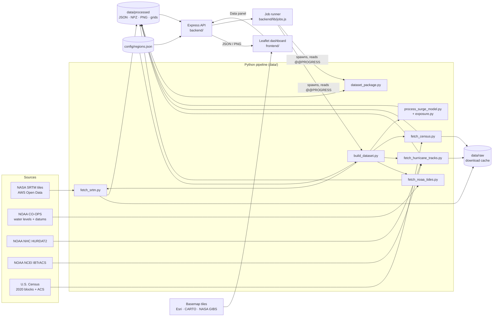

# Architecture

TIDEWATCH has three parts that only talk through files and HTTP:



1. **Pipeline (offline, Python):** downloads sources, runs the flood and
   exposure models, and writes verified, provenance-tagged files. It runs on
   demand, either started from the dashboard's Data panel or from the CLI.
   Nothing is computed at request time except the point lookup.
2. **API (Node/Express):** a thin layer that validates the files and serves
   them. It never invents values. Anything missing or unverified returns 503
   "unavailable". Its only writer is the **job runner**: for an authorized
   user (Local mode or admin token, `lib/auth.js`) it spawns the pipeline
   scripts with validated arguments, one at a time, and relays their
   progress.
3. **Dashboard (browser, ES modules + Leaflet):** renders the map, controls,
   charts and exports. All state is kept in the URL.

## Design principles

| Principle | Where it shows |
|---|---|
| **Verified or unavailable** | Every output has `provenance` (`synthetic: false`, provider, hashes). API validators and `build_dataset.validate_output` reject anything else; the UI shows "Unavailable" rather than estimating |
| **Single source of truth** | Regions and stations live in `config/regions.json`, read by both Python and Node. Model constants live in `data/common.py` (see [[Development_Guide]] for the constants mirrored in JS) |
| **Reproducible** | Raw downloads cached in `data/raw` with URL, time and SHA-256 recorded; deterministic model; `pipeline_manifest.json` summarises each build |
| **Atomic outputs** | Every file is written to `*.part` then renamed, so readers never see half-written files |
| **Map = metrics = Inspect** | WL is rounded once and shared; the lookup grid stores the exact classified elevations (verified 0 mismatches) |
| **Shareable state** | The whole view is encoded in the query string (`frontend/js/urlstate.js`) |
| **Builds can't break the live site** | Scenario outputs are built in a staging folder and swapped in; imports are verified before install; cancel keeps the old data |
| **Least privilege for operations** | Data operations are off on production unless a ≥ 16-char token is set; Local mode is loopback-only and refuses proxied requests; job parameters are whitelisted and run without a shell; package downloads use short-lived HMAC links |
| **Honest people numbers** | Census counts rounded and marked "≈", ACS values "est." with MOE and reliability; regions without coverage say so |
| **No heavy dependencies** | Python: numpy, scipy, requests, python-dotenv. Node: express, cors, morgan, dotenv. Browser: Leaflet only. The PNG encoder, gzip, charts and tools are in-house |

## Request lifecycle (example: choose CAT 3, 2050)

1. `main.js: setCategory(3)` updates the state and pushes a history entry
   (`?c=3…`).
2. `loadScenario()` → `api.js: fetchSurge()` → `GET /api/surge?...`
   (cached in the client for 5 min).
3. `routes/surge.js: loadScenario()` → `lib/data.js: readJson()` (mtime cache)
   → validate → add `overlay.url` → JSON (gzipped).
4. `renderScenario()` updates the metric cards and details table;
   `renderOverlay()` adds an `L.imageOverlay` of the PNG (re-coloured on a
   canvas if some depth bands are hidden).
5. If a Compare/Trend tab is open, `refreshActiveTab()` fetches
   `/api/surge/compare` or `/series`.
6. Stale responses are dropped by request counters (`state.req.*`), so fast
   clicking can never show the wrong scenario.

## Repository map

```
TIDEWATCH/
├── config/regions.json            Regions, bboxes, storm source, NOAA stations
├── data/                          ── Python pipeline ──
│   ├── common.py                  Config loader, constants (surge, SLR, classes), geodesy, HTTP+cache, atomic JSON
│   ├── fetch_srtm.py              SRTM download, block mean, mosaic/crop → elevation_<r>.npz/.json
│   ├── fetch_noaa_tides.py        CO-OPS water levels + datums → tides_<r>.json
│   ├── fetch_hurricane_tracks.py  HURDAT2/IBTrACS parse, classify, select → tracks_<r>.json
│   ├── fetch_census.py            2020 blocks (TIGERweb) + ACS tracts → census_<r>.json/_blocks.npz
│   ├── exposure.py                Place people on the grid, exposure per scenario, FEI, density classes
│   ├── process_surge_model.py     Water level, flood fill, depth classes, areas, overlay PNG, lookup grids
│   ├── build_dataset.py           Orchestrator (stages, staging swap, progress), validation, manifest (CLI)
│   ├── dataset_package.py         Export/import verified .tar.gz dataset packages (CLI)
│   └── test_pipeline.py           Offline unit tests
├── backend/                       ── Node API ──
│   ├── server.js                  App, security headers, gzip, health, routing, error handler
│   ├── lib/data.js                Data dir, mtime-cached JSON reads, safe paths, inventory
│   ├── lib/auth.js                Local / admin-token / disabled modes, lockout, signed download links
│   ├── lib/jobs.js                Job queue: validated commands, spawn, progress parsing, cancel, history
│   ├── lib/estimate.js            Time/download/disk/memory estimates; setup (preflight) checks
│   ├── routes/regions.js          /api/regions
│   ├── routes/surge.js            /api/surge, /compare, /series, /overlay/:file
│   ├── routes/inspect.js          /api/inspect (point lookup)
│   ├── routes/storms.js           /api/storms
│   ├── routes/tides.js            /api/tides
│   ├── routes/census.js           /api/census (+ density overlay), /api/exposure
│   ├── routes/datasets.js         /api/datasets (per-region status for the Data panel)
│   ├── routes/admin.js            /api/admin/* (session, preflight, estimate, jobs, uploads, packages)
│   └── tests/api.test.js          API tests with temp fixtures
├── frontend/                      ── Dashboard ──
│   ├── index.html                 Layout: header, sidebar, map, toolbar, bottom tabs, help + data dialogs, first-run screen
│   ├── css/main.css, app.css      Base layout and theme tokens
│   ├── css/components.css         Legacy component styles (not loaded by index.html)
│   ├── css/ops.css                Controls, tools, tabs, charts, dialogs, Data panel, People views, print, mobile
│   └── js/
│       ├── main.js                App controller: state, map layers, rendering, events
│       ├── api.js                 Fetch client (TTL cache, unavailable-not-throw)
│       ├── urlstate.js            URL ⇄ state (share links, history)
│       ├── tools.js               Inspect / measure tools, geodesic maths, fullscreen
│       ├── charts.js              SVG stacked columns, line, mini columns, tooltips
│       ├── data-panel.js          Data panel, admin sign-in, jobs, packages, setup check, first run
│       ├── people.js              Population formatting, People tab, census popups
│       └── util.js                DOM helpers, units, formatting, CSV, downloads, toasts
├── utils/geomath.js               JS geodesy/SLR helpers (used by API tests)
├── scripts/setup.sh, run_dev.sh   Local setup and dev server
├── Dockerfile, .dockerignore      Production image (Node + Python pipeline; data on a volume)
├── docs/                          This documentation
├── README.md, CHANGES.md, LICENSE
└── requirements.txt, package.json
```

## Runtime & scale

| Item | Value (Gulf region, 3″) |
|---|---|
| Grid | 3600 × 7200 cells (≈ 26 M) |
| Full region build | ~80 s for 40 scenarios + overlays + lookup (after download; measured 77 s) |
| Peak memory | ~635 MB during build (measured) |
| Disk | ~30 MB DEM + ~2.5 MB overlays + 260 MB lookup grids (104 MB f32 + 3 × 52 MB) + a few MB census |
| API scenario response | ~3–5 KB gzipped; overlay 45–70 KB |
| Inspect | O(1): up to four small disk reads (+ a ≤ 13 × 13 cell search for the nearest tract) |
| Jobs | One at a time; progress lines parsed from stdout; log ring buffer of 300 lines |
