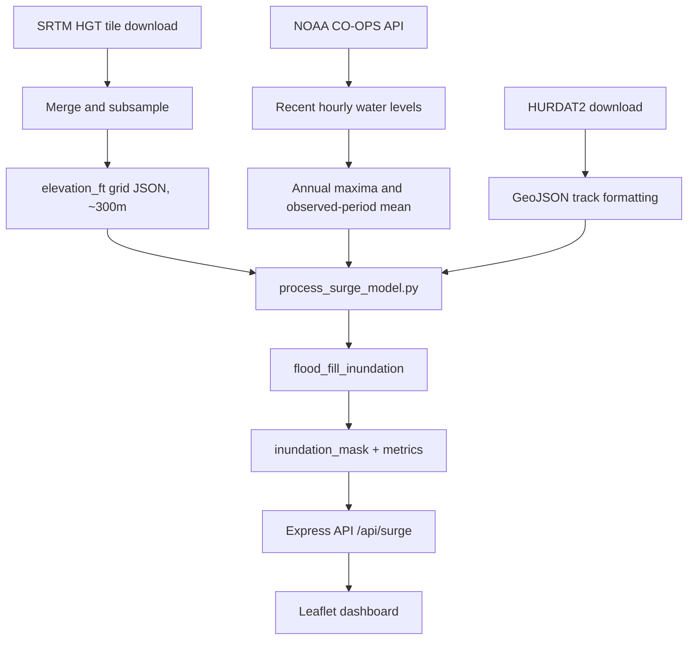

# Methodology

## Scientific Foundation

The current pipeline uses NASA SRTM elevation, NOAA CO-OPS water levels where
stations are configured, HURDAT2 historical tracks, and configured scenario
constants. The analysis grid is approximately 300m after subsampling.

> [!NOTE]
> This is a simplified screening implementation. Census, population, asset,
> MODIS SST, and FEI analysis are not implemented.

---

## 1. NASA SRTM Digital Elevation Model

The Shuttle Radar Topography Mission (SRTM) acquired near-global terrain
data during an 11-day Space Shuttle Endeavour mission in February 2000.
TIDEWATCH uses SRTM v3.0, which incorporates void-filling using ASTER GDEM
and USGS NED data for seamless coverage.

**Processing steps:**
1. Request SRTM HGT tiles covering the configured bounding box
2. Merge adjacent tiles in memory and sample every tenth source pixel
3. Convert valid elevations from meters to feet (`elev_ft = elev_m × 3.28084`)
4. Export the subsampled grid and geographic coordinates as JSON

The resulting grid spacing is approximately 300m. The current fetcher does not
run GDAL reprojection or guarantee 30m analysis resolution.

**Known limitation:** SRTM captures the top of vegetation and structures,
not bare earth. Urban areas may be overestimated by 2–5m. This causes
TIDEWATCH to *underestimate* urban flood risk — a conservative bias.

---

## 2. Bathtub Inundation Model

### Core Formula

A terrain pixel is classified as **inundated** if both conditions are met:

```
condition_1: elevation_ft ≤ surge_height_ft + SLR_offset_ft
condition_2: pixel is connected to a NoData cell on the grid boundary
```

This boundary-NoData approximation is not a verified coastline or ocean
connectivity model. Results depend on the raster bounds and NoData layout.

### Flood-Fill Algorithm

The implementation uses a four-neighbor breadth-first search seeded from
boundary NoData cells. Valid cells above the threshold stop traversal; valid
cells at or below it are marked inundated. Runtime is linear in the grid size.

### Sea Level Rise Offset

SLR offset is added to surge threshold before comparison:

```
surge_threshold = surge_height_ft + (SLR_cm × 0.0328084)
```

The code interpolates this configured SSP2-4.5 table; low and high pathways
are not implemented:

| Year | SLR above 2000 baseline |
|---|---:|
| 2024 | 0.06m |
| 2030 | 0.10m |
| 2040 | 0.17m |
| 2050 | 0.30m |
| 2060 | 0.38m |
| 2075 | 0.56m |
| 2090 | 0.78m |
| 2100 | 1.01m |

---

## 3. Sea Surface Temperature

MODIS SST acquisition, anomaly calculation, and visualization are not
implemented.

---

## 4. NOAA Tidal Observations

The fetcher requests recent water levels in feet using the NOAA MHHW datum,
then stores annual maxima and the average observed level above MHHW. It does
not calculate the official 19-year MHHW datum or combine tide observations
with the surge scenario model.

---

## Processing Pipeline



---

## Model Limitations

> [!WARNING]
> The bathtub model does not simulate wave dynamics, coastal morphology
> changes, or the time-dependent behavior of surge. It systematically
> underestimates risk in areas with complex terrain and overland flow paths.
> NOAA's SLOSH (Sea, Lake, and Overland Surges from Hurricanes) model is
> the operational standard for precise surge forecasting. TIDEWATCH is a
> screening-level tool for vulnerability assessment, not evacuation planning.

---

## References

- Emanuel, K.A. (1987). The dependence of hurricane intensity on climate. *Nature*, 326, 483–485.
- Webster, P.J. et al. (1995). Changes in tropical cyclone number. *Science*, 282, 1–4.
- Farr, T.G. et al. (2007). The Shuttle Radar Topography Mission. *Reviews of Geophysics*, 45.
- IPCC (2021). AR6 WG1 Chapter 9, Table 9.9. Sea level projections.
- Irish, J.L. & Resio, D.T. (2010). A hydrodynamics-based surge scale. *Ocean Engineering*, 37.
