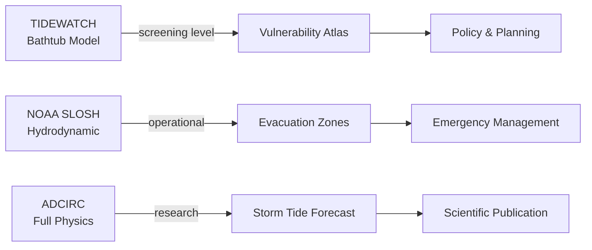

# Storm Scenarios

## Saffir-Simpson → Surge Height Mapping

The model maps Saffir-Simpson categories to fixed scenario surge heights
(feet above MHHW), taken from the upper bound of each range in the legacy
(pre-2010) Saffir-Simpson scale. NHC removed surge from the scale in 2010
because surge depends on storm size, forward speed, track angle, and
bathymetry, so these are screening scenarios, not category forecasts.

| Category | Wind (kt, 1-min) | Legacy surge range | Scenario value | Track colour |
|---|---|---|---|---|
| TD    | < 34    | —        | —       | `#4a90d9` |
| TS    | 34–63   | —        | —       | `#2bb3a3` |
| CAT 1 | 64–82   | 4–5 ft   | 5 ft    | `#f2d33b` |
| CAT 2 | 83–95   | 6–8 ft   | 8 ft    | `#f39c34` |
| CAT 3 | 96–112  | 9–12 ft  | 12 ft   | `#e8592a` |
| CAT 4 | 113–136 | 13–18 ft | 18 ft   | `#c8202f` |
| CAT 5 | ≥ 137   | > 18 ft  | 28 ft ¹ | `#8e1b74` |

¹ No upper bound exists; 28 ft approximates the highest reliably measured
US storm tide (Katrina 2005, ~27.8 ft high-water mark at Pass Christian, MS).

> [!WARNING]
> Category is a poor predictor of surge. Katrina was Category 3 at its
> Mississippi landfall yet produced the record surge because of its very
> large wind field and the shallow, concave Mississippi Bight.

---

## Why Bathtub Understates Risk

The pure elevation threshold model fails to account for:

1. **Wave setup** — breaking waves add 20–30% to total water level
2. **Storm size** — larger storms push more water onshore regardless of intensity
3. **Track angle** — onshore track produces higher surge than parallel track
4. **Bathymetry** — shallow sloping seafloor amplifies surge (Gulf Coast)
5. **Back-barrier flooding** — water overtops barrier islands and fills bays

NOAA's **SLOSH** (Sea, Lake, and Overland Surges from Hurricanes) model
accounts for all of these factors using a finite-difference hydrodynamic
grid. TIDEWATCH is a screening tool; SLOSH is the operational standard.

---

## Historical Context (Not Model Inputs)

Figures are from NHC Tropical Cyclone Reports unless noted. Note the
difference between *storm tide* (water level above a tidal datum) and
*inundation* (water depth above ground).

### Hurricane Katrina (2005) — Gulf Coast
- Peak storm surge: **~27.8 ft** (high-water mark, Pass Christian, MS)
- Category 3 at Mississippi landfall; very large wind field
- Damage: ~$125B (NCEI)

### Hurricane Sandy (2012) — Atlantic
- Record storm tide **14.06 ft above MLLW** at The Battery, NY (CO-OPS 8518750)
- Post-tropical at landfall; unusually wide wind field

### Hurricane Ian (2022) — Florida
- Peak inundation **10–15 ft above ground** at Fort Myers Beach
- At least 156 US fatalities (66 direct) | Damage: ~$112.9B (NCEI)

### Hurricane Maria (2017) — Caribbean
- Peak inundation **6–9 ft above ground** (Humacao, Naguabo, Ceiba, PR)
- Puerto Rico government fatality estimate: 2,975 (direct + indirect)

### 1991 Bangladesh Cyclone (02B) — Bay of Bengal
- Storm surge roughly **6 m (~20 ft)** near Chittagong
- ~138,000 deaths. (The 1970 Bhola cyclone, ~300,000–500,000 deaths, was deadlier.)

---

## SLOSH vs TIDEWATCH

> [!TIP]
> TIDEWATCH is designed to answer "which communities are most exposed?"
> SLOSH is designed to answer "exactly where will the water go on Tuesday?"
> Both questions matter. They require different tools.
