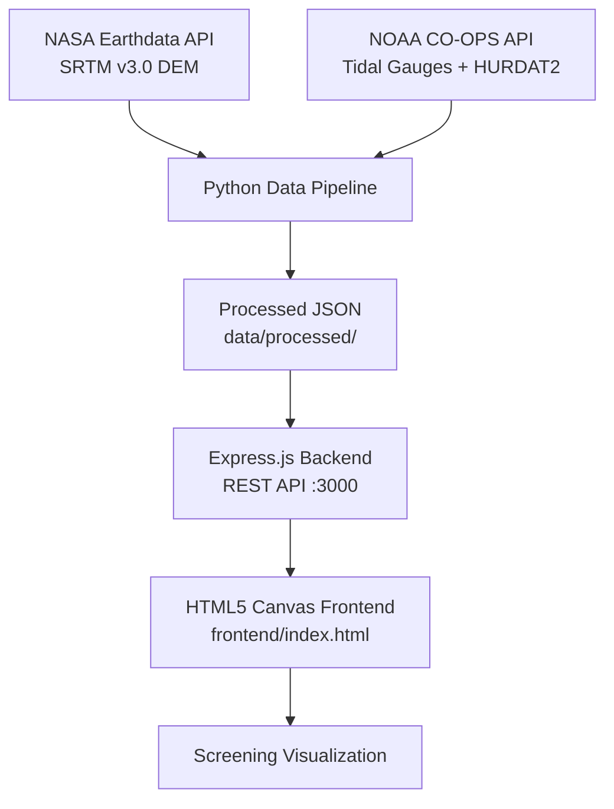
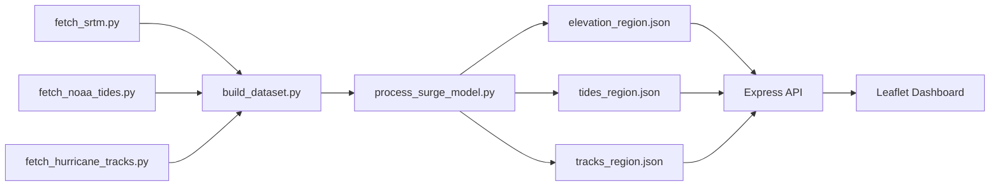

# TIDEWATCH — Project Overview

## What Is TIDEWATCH?

TIDEWATCH is an early-stage coastal screening prototype. Its active dashboard
loads configured regions and requests scenario, tide, and historical storm data
from an Express API. Outputs are shown only when the API has verified source
metadata; population, asset, and equity analysis are not implemented.

> [!NOTE]
> This prototype is not an operational forecast or a substitute for FEMA,
> NOAA SLOSH, or other validated emergency-management tools.

---

## System Architecture

---

## Data Pipeline Flow

---

## Current Coverage

| Region | Configured tide stations | HURDAT2 archive |
|---|---|---|---|
| Gulf Coast | Yes | Atlantic |
| Atlantic | Yes | Atlantic |
| Florida | Yes | Atlantic |
| Pacific CA | Yes | Eastern Pacific |
| Caribbean | Yes | Atlantic |
| Bay of Bengal | No | Not covered |

The surge model reports inundated area from an approximately 300m subsampled
elevation grid. It does not produce population exposure, critical-asset counts,
or FEI scores. SRTM downloads, tide observations, and track archives can be
unavailable; the API reports those cases instead of substituting sample results.

---

## Related Docs

- [[Methodology]] — Scientific basis for the inundation model
- [[Equity_Analysis]] — Flood Equity Index framework and findings
- [[NASA_Grant_Summary]] — ROSES-format project abstract
- [[FEMA_Brief]] — 2-page actionable policy brief
- [[Storm_Scenarios]] — Saffir-Simpson surge mapping
