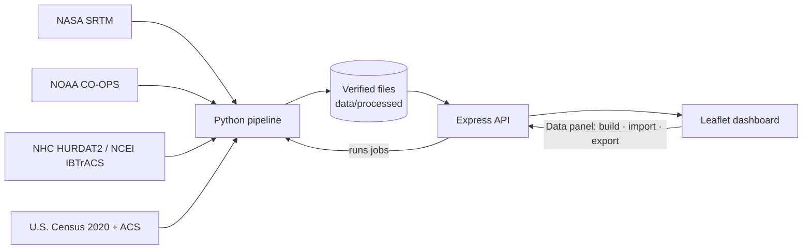

# TIDEWATCH — Project Overview

## What it is

TIDEWATCH is a coastal flood **screening** atlas for six study regions. For
any storm category (1–5) and sea-level-rise year (2024–2100), it maps where
water would reach and how deep, using NASA SRTM elevation, NOAA tidal datums
and IPCC AR6 sea-level rise, and it counts the 2020 Census residents and
homes in the flooded area, with the ACS income, poverty and age profile of
the affected tracts. The map sits alongside the historical storm tracks and
tide-gauge records that give the scenarios context. Data is built, refreshed,
imported and exported from the dashboard itself (the Data panel), locally or
by a signed-in admin on a deployment.

> [!NOTE]
> Not an operational forecast. It doesn't replace NOAA SLOSH, NHC Potential
> Storm Surge Flooding maps, or FEMA flood maps. See the limitations in
> [[Methodology]] §15.

## What it computes

| Output | How |
|---|---|
| Flood extent and depth (NHC bands) | Connected bathtub on a ~90 m SRTM grid; WL = surge above MHHW + regional MHHW−MSL + AR6 SLR |
| Inundated area, % of land, area per depth band | Exact spherical cell areas |
| Low-lying but not connected land | Reported separately (NOAA SLR Viewer convention) |
| Point answers (Inspect) | Per-cell elevation and lowest flooding level |
| Storm climatology near each region | HURDAT2 / IBTrACS tracks with per-fix intensity, closest approach and landfalls |
| Gauge context | NOAA annual maxima, completeness, record high water, datums |
| Residents and homes exposed (by depth band, by tract) | 2020 Census blocks placed on the grid ([[Methodology]] §13) |
| Who is exposed | ACS 5-year shares (65+, poverty), exposure in low-income tracts, Flood Equity Index, income ± MOE with reliability |
| Population density | Residents per km² on ~1 km cells |

## What it doesn't compute (yet)

Critical facilities, roads or property values; daytime or projected
population; the social-vulnerability indices proposed in [[Equity_Analysis]]
beyond the FEI; SST, levees and drainage, waves, rainfall, local subsidence,
or live advisories. See [[Development_Guide]] → "Known gaps &
next steps".

## System at a glance

Details: [[Architecture]].

## Coverage

| Region | Tide stations (NOAA CO-OPS) | Storm tracks | Census |
|---|---|---|---|
| Gulf Coast (LA/MS) | Grand Isle, Pilots Station East, Pascagoula, Dauphin Island | HURDAT2 Atlantic | ✓ |
| Atlantic (NY/NJ) | The Battery, Sandy Hook, Kings Point, Robbins Reef | HURDAT2 Atlantic | ✓ |
| Florida | Vaca Key, Naples, Lake Worth Pier, Virginia Key | HURDAT2 Atlantic | ✓ |
| Pacific CA | Monterey, Port San Luis, Santa Barbara, Santa Monica | HURDAT2 NE Pacific | ✓ |
| Caribbean (PR/USVI) | San Juan, Magueyes Island, Charlotte Amalie, Christiansted | HURDAT2 Atlantic | Puerto Rico ✓; USVI partial (no ACS) |
| Bay of Bengal | none (no MHHW datum correction) | IBTrACS North Indian | — |

## Documentation map

| Doc | Read it to… |
|---|---|
| [[Methodology]] | understand or change any calculation (all formulas and constants) |
| [[Data_Formats]] | read or write any data file |
| [[API]] | call or extend the REST API |
| [[Frontend]] | change the dashboard |
| [[Pipeline_Operations]] | use the Data panel or CLI, packages, deploy, troubleshoot |
| [[Development_Guide]] | make changes safely, test, plan next work |
| [[Color_And_Graph_Guide]] | map symbology and chart encoding |
| [[Storm_Scenarios]] | surge-height rationale and historical context |
| [[Equity_Analysis]], [[FEMA_Brief]], [[NASA_Grant_Summary]], [[Research_Questions]] | proposals and future research (planning documents; the FEI part of Equity_Analysis is implemented in v2.2) |

## History

- **v1** — Leaflet + Express prototype: 300 m subsampled SRTM, single-colour
  tracks, metrics only.
- **v2.0** — Scientific corrections (AR6 table, datum offset, station IDs),
  90 m block-mean DEM, depth overlay, intensity-coloured tracks, IBTrACS,
  hardened API.
- **v2.1** — Operational controls (layers, filters, Inspect, measure,
  compare/trend charts, exports, share links, units, help) and full
  documentation.
- **v2.2** — Data operations from the dashboard (Data panel: build, refresh,
  recompute, cancel, history, estimates, packages, setup check, first-run
  screen; Local and admin-token modes) and population exposure from the
  2020 Census and ACS (People tab, population layer, Inspect, equity
  index). See `CHANGES.md`.
